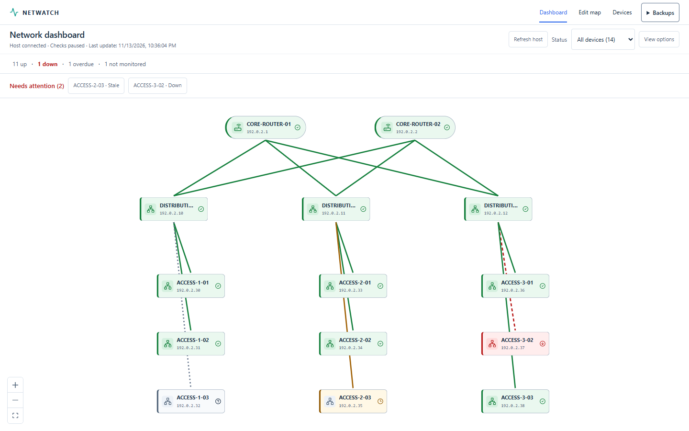

# NetWatch

NetWatch is a Windows network-monitoring dashboard with a topology editor, device reachability checks and recent history. A fresh installation starts with an empty network. There are no built-in devices, example addresses, demo statuses or preview mode.

## Screenshots

Screenshots use a test inventory with documentation addresses.

| Dashboard | Edit map | Devices on a narrow screen |
| --- | --- | --- |
|  |  |  |

## Windows setup

Requirements: Windows 10/11, Node.js 22.13 or newer with npm, and the Windows .NET Framework v4 compiler/runtime used by the launcher and checks.

1. Download and extract this repository into a permanent folder, or clone it.
2. Open PowerShell in the folder containing `package.json`.
3. Run:

```powershell
npm.cmd ci
npm.cmd run build
npm.cmd run desktop:setup -- --desktop-shortcut
```

4. Open the **NetWatch** desktop shortcut.
5. Enable its **Check devices on next start** checkbox if you want reachability checks, then click **Start** and **Open dashboard**.

The dashboard is available at **http://127.0.0.1:4317** by default. Set `NETWATCH_PORT` to a free port from 1024 through 65535 in the environment before starting the host or the launcher. No administrator access or PowerShell execution-policy change is required. Keep the repository folder and Node installation in place; rerun setup if either moves. Quit NetWatch before updating its launcher.

For release acceptance, safe updates and recovery, see the [Windows release runbook](docs/WINDOWS-RELEASE-RUNBOOK.md).

## Add your devices

1. Open **Edit map**, choose **Add device**, and enter a device name and its actual IPv4 or IPv6 address. An empty address is allowed for a device you do not monitor.
2. Arrange devices and add their configured links. The editor saves a working copy in this browser.
3. Choose **Use this map** above the editor to prepare a fresh replacement review.
4. Review the replacement and choose **Confirm replacement**. New or changed devices start with monitoring disabled.
5. Return to **Dashboard**, open a device and choose **Turn checks on**; select the monitored network under **View options → Show** if needed.

Local network discovery is opt-in through the launcher and lists neighbors on the computer's directly attached IPv4 networks for review. Discovery requires an explicit Add to map action. On the NetWatch PC, **Add to map** turns checks on for that device, and the launcher’s ICMP setting must be on for checks to run. Remote admins add devices with checks off and can turn them on in device details. Only enable checks for devices you manage; the launcher's ICMP setting and each saved device's monitoring setting are separate approvals. Wi-Fi isolation, blocked pings, randomized phone hardware addresses, and other subnets or VLANs can hide devices. See [Discovery](docs/DISCOVERY.md).

## Read device status

An optional Windows-host SNMPv3 feature adds interface status and traffic rates under device details → **Ports**. It requires local credential enrollment and separate opt-in; it does not change ping-based device health. See [SNMP interface setup](docs/SNMP-INTERFACES.md). Cisco 3750/2811 physical verification is pending.

- **Up:** recent checks confirm a response.
- **Down:** two consecutive failed checks confirm no response; the first successful reply restores Up.
- **Overdue:** the last check is too old to describe the device's current state.
- **Not monitored:** monitoring is disabled, no address is configured, or no confirmed result is available.

The collector normally checks every 10 seconds. The dashboard polls every second, reuses unchanged snapshots, and ages checks using the host's freshness policy (at least 30 seconds, increasing with device count). Host disconnection preserves the last-known result and its timestamp; it does not turn devices Down. Device details show last check, measured response time, service state and collapsible recent history, 25 checks per page up to 200 displayed. No uptime percentage is inferred.

Per-check history keeps roughly the most recent 5,000 stored checks per device. That covers about 3.5 days of stable one-minute samples and less when status or outcomes change often. Status, outcome and reason changes and outage transitions are always stored. A network-wide safety cap of 1,000,000 rows and a 30-day age ceiling can shorten that history.

Line colors summarize endpoint reachability, not verified cable, interface or routing-session health. A responding switch remains Up when a connected router fails.

## Edit, back up and restore

**Monitored network** shows the host's saved devices and real checks. **Draft map** shows your local edits without live health. Loading or saving host inventory is an explicit reviewed replacement, not automatic synchronization.

Use **Backups → Download map** to keep a copy of your draft, or **Edit map → Load saved map** to review the monitored map before downloading it. **Restore map** checks a backup file and asks before replacing the draft; **Use this map** applies the draft to the dashboard separately. **Use this map** and loading or restoring a map never turn checks on for a new or changed device. Updates preserve saved maps and history; remove unwanted devices in the editor and review **Use this map** to apply the change.

Both maps open in the compact Circle layout; Tidy layout remains available. Connected devices stay grouped. Dragging a card against another pushes it out of the way. Moved devices stay in place until you leave the map, switch browser tabs, or reload. A move snaps back to its last valid position only if a connection stretches too far. Limits are 1.5× the arranged connection length, with a minimum reach of 320 layout pixels; unconnected devices can move freely. Drag adjustments only affect the open map. Connections are undirected: opposite or repeated entries draw one line, and adding the reverse link is blocked. Search stays beside the map; counts, Status and Needs attention are visible, while layout settings are in **View options**; the **Devices** page offers a keyboard-operable list. Device details open with a click or Enter/Space.

The launcher stores data under `%LOCALAPPDATA%\NetWatch\data\netwatch.sqlite`; its control window shows the location. Browser JSON exports contain topology only, not history. For full database backup/restore, stop the host and follow [HOST-API.md](docs/HOST-API.md). A lock held by a running process blocks startup. NetWatch logs and replaces locks from dead local processes and ownerless or unreadable locks older than 60 seconds. Stop the owning process before maintenance. Never delete a database to resolve a startup error.

## Start and stop

For another PC to open the dashboard, enable **Allow other PCs on this network** in the Windows launcher, set an admin password under **Remote access**, choose a viewer mode, and start the host. Use a URL shown by the launcher. Plain HTTP exposes passwords and session data to anyone who can intercept LAN traffic. Configure direct HTTPS before signing in from another PC on a network you do not fully trust. See [Remote access](docs/REMOTE-ACCESS.md).

Closing the browser or hiding the control window keeps monitoring running. **Stop** stops the host; **Quit** stops it and exits the tray app. The PC must remain awake, connected and signed in. Automatic boot startup and unattended Windows service operation are not implemented.

For a terminal-based setup, build once and run:

```powershell
$env:NETWATCH_ICMP = '1'
npm.cmd start
```

This enables the collector for devices you separately authorize; it does not add or authorize devices. Omit the environment setting to start with collection disabled. Keep that terminal open and use Ctrl+C to stop. Terminal mode defaults to `data/netwatch.sqlite` in the repository, separately from the launcher's database.

## Development and verification

Loopback API writes use the per-launch token. Remote admin writes use their session CSRF token. See [Host API](docs/HOST-API.md).

NetWatch uses the experimental `node:sqlite` API in Node.js 22. Before upgrading Node, verify the host and its migrations with the test suite against the target Node version.

```powershell
npm.cmd test
npm.cmd run build
npm.cmd run dev
```

The Vite development UI is browser-only and does not run the monitoring host. Use the built app served by the host on its configured port for monitoring. Optional browser checks in `scripts/check-*-browser.mjs` use the Playwright dev dependency and Chromium; set `PLAYWRIGHT_MODULE`, `CHROMIUM_PATH` and `NETWATCH_URL` as needed. On Windows, an absolute module path must be a `file:///` URL. Test inventories and synthetic observations live under `tests/fixtures/`; they are not bundled into the application or probed.

## Remaining work

Authentication and role enforcement (#10) and opt-in private-network access with optional direct HTTPS (#12) are implemented. Per-user accounts, SSO, automatic certificate provisioning, unattended Windows service packaging and second-PC release verification remain open. Local outages and SNMP interfaces are available. External notifications, LLDP and broader redundancy work remain planned.

See [ROADMAP.md](docs/ROADMAP.md), [Windows launcher](docs/WINDOWS-LAUNCHER.md), [monitoring policy](docs/ICMP-COLLECTOR.md), and [WORKLOG.md](docs/WORKLOG.md) for details and evidence.

### Outages and recovery

In device details, expand **Incidents** to see outages and recovery times; **View checks** opens the recent check history. Two failed checks open an outage, and the next reply confirms recovery. Repeated failures keep one outage open. **View options → Needs attention** includes open outages. Paused or disconnected monitoring leaves incidents open until a reply confirms recovery; check freshness and monitoring state before acting.

Incidents survive host restart. Resolved incidents are kept for up to 30 days, with a 10,000-record network-wide limit. Removing a device or replacing its address/type removes its old incident evidence. Existing databases upgrade automatically; back up before upgrading. Only new confirmed results create incidents after upgrade. External email/chat notifications remain planned and send nothing.

The dashboard summary counts and Status filter narrow the displayed devices; Needs attention includes down/overdue devices and open outages. Edit map adds new devices to the next free grid cell. Removing a device asks for confirmation. Routers fit their content in an oblong shape; long names use a tooltip. Devices uses cards on narrow screens, and Backups opens below navigation. Dashboard/Edit map/Devices links support reload and browser Back/Forward.
