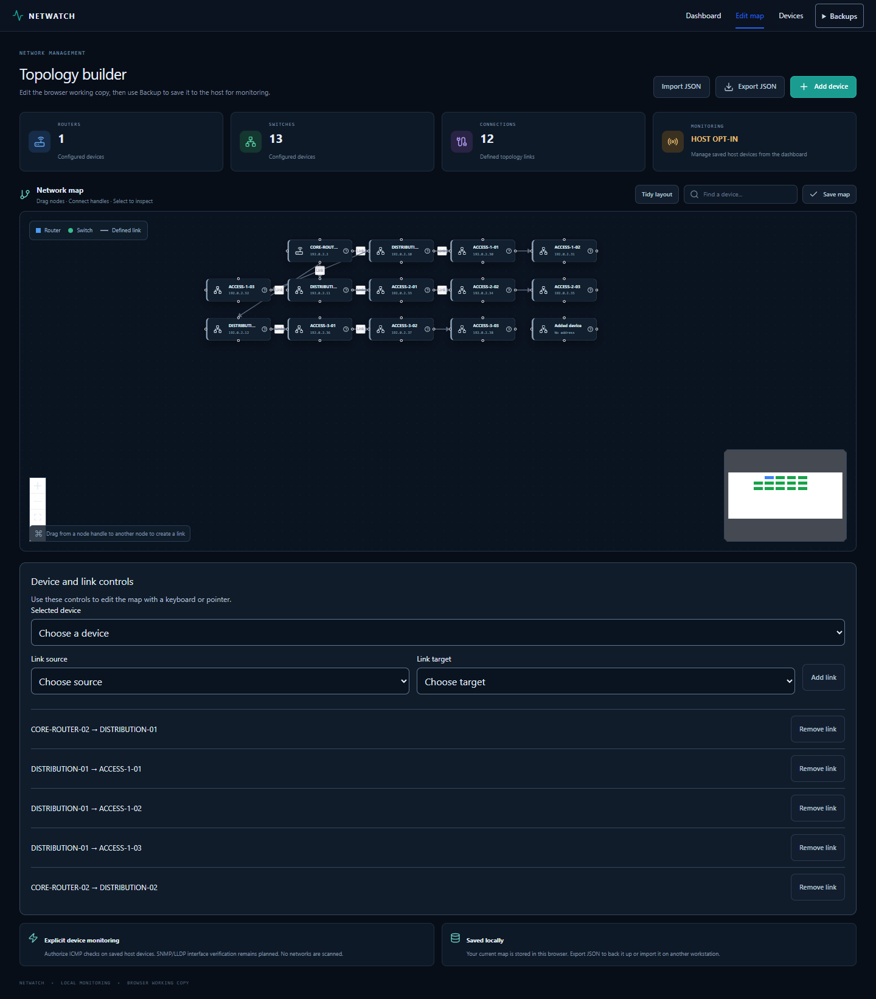
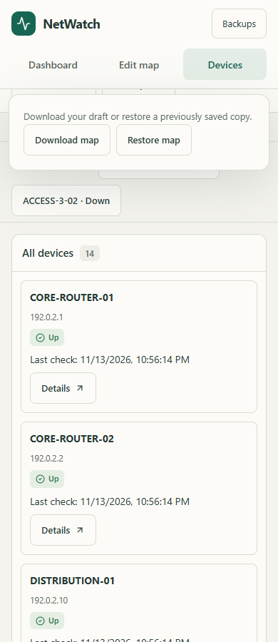

# NetWatch

NetWatch helps you see which switches, routers, and other devices on your network are responding. You start with an empty map and add the devices you want to check.

## Screenshots

Screenshots use a test inventory with documentation addresses.

| Dashboard | Edit map | Devices on a narrow screen |
| --- | --- | --- |
|  |  |  |

## Set up NetWatch on Windows

### 1. Install NetWatch

1. On the Windows 10 or 11 PC you want to use for monitoring, open the [latest NetWatch release](https://github.com/Osbornejmb/netwatch/releases/latest).
2. Under **Assets**, download the file whose name ends in **Windows-x64-Setup.exe**. This is the installer for 64-bit Windows PCs with Intel or AMD processors. It includes everything NetWatch needs to run.
3. Open the downloaded file and follow the prompts. For your first setup, leave **Set up access from another PC on my private network** unchecked. You can [set up sharing later](docs/REMOTE-ACCESS.md#windows-installer-setup).

### 2. Open the dashboard

1. Open the Windows **Start** menu, search for **NetWatch**, and open the app.
2. Select **Check devices on next start**. This lets NetWatch ask the devices you choose whether they are responding.
3. Click **Start**, wait until NetWatch says it is running, then click **Open dashboard**. The dashboard opens in your web browser and runs from this PC.

### 3. Add your first switch or router

1. Find its **management IP address**, the network address you use to open the device’s settings. If you don’t know it, ask the person who set up the device. You can also try [Find a device automatically](#find-a-device-automatically).
2. In the dashboard, choose **Edit map → Add device**. Choose **Switch** or **Router**, enter a name you’ll recognize and the device’s IP address, then choose **Add device**.
3. Choose **Use this map**, review the device you added, then choose **Confirm replacement**. This applies your draft map so the running app can use it.
4. Return to **Dashboard**. If you’re still looking at your draft, choose **View options → Show → Monitored network**.
5. Select the device and choose **Turn checks on**. Wait for **Last check** to show a time. **Up** means the device answered the check. If the check fails, confirm the address and that this PC can reach it.

### 4. Optional — see what is connected to a switch port

1. Ask whoever manages the switch for a read-only **SNMPv3** account. SNMPv3 is how NetWatch securely reads port information, and a read-only account lets it look without changing the switch.
2. In the Windows NetWatch app, click **Stop** and wait for it to finish. Then open **Port monitoring** and choose the switch you saved.
3. Enter the username, choose the password-checking method the switch uses, and enter the authentication and privacy passwords. Those passwords let NetWatch prove it can access the switch and keep the replies private.
4. Click **Test connection**. If the test passes, choose **Enable monitoring**, then close the setup window and click **Start**.
5. Open the dashboard, select the switch, and expand **Ports** to see whether its ports are up. Expand **Network neighbors** to see connected devices that announce themselves using **LLDP**, a way for devices to share their name and port with a directly connected neighbor. [Port and neighbor setup](docs/SNMP-INTERFACES.md)

Discovered port matches appear under **Connections** after the device is added to the map. Set up port monitoring on each managed switch to locate devices behind a trunk. [Discovery port matching](docs/DISCOVERY.md#switch-port-matches)

Keep the NetWatch PC awake, connected, and signed in while you want checks to run. Start NetWatch again after signing back in. For updates and uninstall steps, see the [Windows launcher guide](docs/WINDOWS-LAUNCHER.md).

### Find a device automatically

1. In the Windows NetWatch app, click **Stop** and wait for it to finish. Turn on **Discover local network neighbors on next start**, then click **Start** and **Open dashboard**.
2. In the dashboard, open **Discovered devices → Scan now** and wait for the scan to finish. NetWatch looks on the nearby private networks the PC is directly connected to.
3. If you recognize your device, choose **Add to map**. On the NetWatch PC, **Add to map** allows checks for that device. Checks run when **Check devices on next start** was enabled at startup. If you can’t find the device, ask for its address and add it manually. [Discovery guide](docs/DISCOVERY.md)

### Set up from the project files

Use these steps if you want to run NetWatch from its project files. The Windows installer above is the simplest option for regular use.

1. Install [Node.js LTS](https://nodejs.org/en/download), version 22.13 or newer, using its Windows installer and the default options. Node.js runs NetWatch, and its included tool, npm, gets the extra files the app needs.
2. From the [latest release](https://github.com/Osbornejmb/netwatch/releases/latest), download **Source code (zip)**. In File Explorer, right-click the download, choose **Extract All**, and extract it to a folder you’ll keep, such as **Documents**.
3. Open the extracted folder that contains `package.json`. PowerShell is where you enter the setup commands, and opening it from this folder lets the commands find the project files. Click the File Explorer address bar, type `powershell`, and press **Enter**.
4. Download the packages, which are extra pieces of software NetWatch needs.

   ```powershell
   npm.cmd ci
   ```

5. Build the dashboard, which prepares the files the browser will open.

   ```powershell
   npm.cmd run build
   ```

6. Create the Windows launcher and desktop shortcut so you can start NetWatch without typing commands again.

   ```powershell
   npm.cmd run desktop:setup -- --desktop-shortcut
   ```

7. Open **NetWatch** from the desktop shortcut, then continue with step 2 under [Open the dashboard](#2-open-the-dashboard). Keep the project folder and Node.js installation in place so the shortcut can find them.

For help with launcher setup, see the [Windows launcher guide](docs/WINDOWS-LAUNCHER.md#source-setup).

## Read device status

An optional Windows-host SNMPv3 feature adds interface status and traffic rates under device details → **Ports**. In the Windows launcher, stop the host and choose **Port monitoring** to test and enroll a saved device for port checks; it does not change ping-based device health. See [SNMP interface setup](docs/SNMP-INTERFACES.md). Cisco 3750/2811 physical verification is pending.

Use **Edit map → Uplinks & redundancy** to map ports to connections and group alternate router links. The dashboard reports group status from port readings while map line colors continue to show device reachability.

- **Up:** recent checks confirm a response.
- **Down:** two consecutive failed checks confirm no response; the first successful reply restores Up.
- **Overdue:** the last check is too old to describe the device's current state.
- **Not monitored:** monitoring is disabled, no address is configured, or no confirmed result is available.

The collector normally checks every 10 seconds. The dashboard receives live snapshots from the host and checks periodically if the live connection is unavailable. The browser uses host time and the freshness policy (at least 30 seconds, increasing with device count) to age checks locally. Host disconnection preserves the last-known result and its timestamp. Device details show last check, measured response time, service state and collapsible recent history, 25 checks per page up to 200 displayed. No uptime percentage is inferred.

Per-check history keeps roughly the most recent 5,000 stored checks per device. That covers about 3.5 days of stable one-minute samples and less when status or outcomes change often. Status, outcome and reason changes and outage transitions are always stored. A network-wide safety cap of 1,000,000 rows and a 30-day age ceiling can shorten that history.

Line colors summarize endpoint reachability, not verified cable, interface or routing-session health. A responding switch remains Up when a connected router fails.

## Edit, back up and restore

**Monitored network** shows the host's saved devices and real checks. **Draft map** shows your local edits without live health. Loading or saving host inventory is an explicit reviewed replacement, not automatic synchronization.

Use **Backups → Download map** to keep a copy of your draft, or **Edit map → Load saved map** to review the monitored map before downloading it. **Restore map** checks a backup file and asks before replacing the draft; **Use this map** applies the draft to the dashboard separately. **Use this map** and loading or restoring a map never turn checks on for a new or changed device. Updates preserve saved maps and history; remove unwanted devices in the editor and review **Use this map** to apply the change.

Both maps open in the compact Circle layout; Tidy layout remains available. Connected devices stay grouped. Dragging a card against another pushes it out of the way. Moved devices stay in place until you leave the map, switch browser tabs, or reload. A move snaps back to its last valid position only if a connection stretches too far. Limits are 1.5× the arranged connection length, with a minimum reach of 320 layout pixels; unconnected devices can move freely. Drag adjustments only affect the open map. Connections are undirected: opposite or repeated entries draw one line, and adding the reverse link is blocked. Search stays beside the map; counts, Status and Needs attention are visible, while layout settings are in **View options**; the **Devices** page offers a keyboard-operable list. Device details open with a click or Enter/Space.

The launcher stores data under `%LOCALAPPDATA%\NetWatch\data\netwatch.sqlite`; its control window shows the location. Browser JSON exports contain topology only, not history. For full database backup/restore, stop the host and follow [HOST-API.md](docs/HOST-API.md). A lock held by a running process blocks startup. NetWatch logs and replaces locks from dead local processes and ownerless or unreadable locks older than 60 seconds. Stop the owning process before maintenance. Never delete a database to resolve a startup error.

## Start and stop

To share the dashboard, follow the [direct HTTPS setup](docs/REMOTE-ACCESS.md#direct-https), enable **Allow other PCs on this network**, set an admin password, choose a viewer mode, and click **Start**. Open the HTTPS URL shown in **Remote access** on the other PC.

Closing the browser or hiding the control window keeps monitoring running. **Stop** stops the host. **Quit** stops it and exits the tray app. The PC must remain awake, connected and signed in. Start NetWatch manually after signing in.

To start NetWatch without the Windows launcher, first install the packages and build the dashboard using the [project files steps](#set-up-from-the-project-files).

An environment variable is a setting you give to the app before it starts. Set this one if you want NetWatch to check whether the devices you approve are responding.

```powershell
$env:NETWATCH_ICMP = '1'
```

Start the local server, the part of NetWatch that runs the checks and sends the dashboard to your browser on this PC.

```powershell
npm.cmd start
```

Open **http://127.0.0.1:4317** in your browser. Keep PowerShell open while NetWatch runs and press **Ctrl+C** there to stop it. This way of starting NetWatch keeps its saved data in `data/netwatch.sqlite` inside the project folder. The Windows launcher uses its own saved data location.

## Development and verification

Loopback API writes use the per-launch token. Remote admin writes use their session CSRF token. See [Host API](docs/HOST-API.md).

NetWatch uses the experimental `node:sqlite` API in Node.js 22. Before upgrading Node, verify the host and its migrations with the test suite against the target Node version.

Run the automated tests to check that the app still behaves as expected.

```powershell
npm.cmd test
```

Build the dashboard to prepare the files NetWatch uses during regular operation.

```powershell
npm.cmd run build
```

Start the development preview to see dashboard changes while you edit the project.

```powershell
npm.cmd run dev
```

The Vite development UI is browser-only and does not run the monitoring host. Use the built app served by the host on its configured port for monitoring. Optional browser checks in `scripts/check-*-browser.mjs` use the Playwright dev dependency and Chromium; set `PLAYWRIGHT_MODULE`, `CHROMIUM_PATH` and `NETWATCH_URL` as needed. On Windows, an absolute module path must be a `file:///` URL. Test inventories and synthetic observations live under `tests/fixtures/`; they are not bundled into the application or probed.

## Remaining work

NetWatch supports viewer and admin roles, local password recovery, and redacted audit export (#10). Private-network access is opt-in and requires direct HTTPS (#12). Per-user accounts, SSO, automatic certificate provisioning and second-PC release verification remain open. Local outages and SNMP interfaces are available. Admins can review LLDP neighbor proposals under saved device details. Hardware verification, optional chat notifications and broader redundancy work remain pending.

See [ROADMAP.md](docs/ROADMAP.md), [Windows launcher](docs/WINDOWS-LAUNCHER.md), [monitoring policy](docs/ICMP-COLLECTOR.md), and [WORKLOG.md](docs/WORKLOG.md) for details and evidence.

### Outages and recovery

In device details, expand **Incidents** to see outages and recovery times; **View checks** opens the recent check history. Two failed checks open an outage, and the next reply confirms recovery. Repeated failures keep one outage open. **View options → Needs attention** includes open outages. Paused or disconnected monitoring leaves incidents open until a reply confirms recovery; check freshness and monitoring state before acting.

Incidents survive host restart. Resolved incidents are kept for up to 30 days, with a 10,000-record network-wide limit. Removing a device or replacing its address/type removes its old incident evidence. Existing databases upgrade automatically; back up before upgrading. Only new confirmed results create incidents after upgrade. Optional chat notifications remain planned.

The dashboard summary counts and Status filter narrow the displayed devices; Needs attention includes down/overdue devices and open outages. Edit map adds new devices to the next free grid cell. Removing a device asks for confirmation. Routers fit their content in an oblong shape; long names use a tooltip. Devices uses cards on narrow screens, and Backups opens below navigation. Dashboard/Edit map/Devices links support reload and browser Back/Forward.
